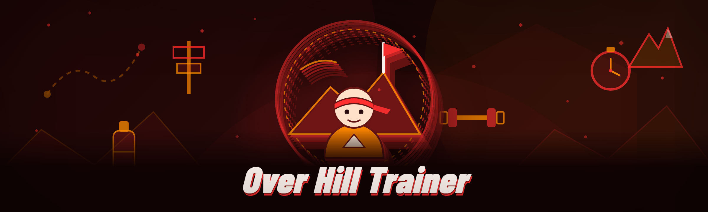

  
  
  

  

  
  
  

---

Built for the over the hill Trainer community and released in early 2026 after a full rewrite that threw out every scrap of legacy code. Six months of forum lurking, Discord dumpster-diving, and incremental patching between broken updates later, this is the free version I wished existed back when the paid trainers wanted a monthly fee for basic module toggles.

This repo is the landing page. The 

  

 macro is the whole getting-started path: hit the project page, grab the archive, extract, run `.exe`. No pip, no npm, no git clone, no environment wrangling — just a Windows desktop tool that does exactly what its name says with hand-keyed bindings and a flat settings file.

> Real talk: this is a community trainer for a single-player / private-session-casual sort of context. If you're taking it onto a truly competitive public server you're asking for a ban — see the **Detection bypass status** section before you even open the .exe. 

  

 again when the annual rebuild drops.

## 📖 Table of Contents

- [Overview](#overview)
- [What is over the hill Trainer](#what-is-over-the-hill-trainer)
- [The Solution](#the-solution)
- [Quick Start](#quick-start)
- [Module catalog](#-module-catalog--core-living--hotbar)
- [Hotkeys / Controls](#hotkeys--controls)
- [Installation](#installation)
- [Known Issues](#known-issues)
- [Detection / Bypass status](#detection--bypass-status)
- [Usage guidelines](#usage-guidelines)
- [Community & Support](#community--support)
- [FAQ](#faq)

## 🗺️ Overview

| Category | Details |
|---|---|
| Distribution | Single Windows `.exe` dropped into the game folder, read at launch |
| Config model | Plain `settings.ini` next to the `.exe` — hand-editable, no registry writes |
| Process mode | External overlay read + guided input simulation (toggle wallhack/aimbot/esp modules from the panel) |
| Rewrite status | 2026 rebuild collapsed ~120 legacy patches into 19 modules on a new dispatcher loop |
| Session safety | Rate-limited input, randomized human curve, and a kill-switch bound to a hotkey of your choice |
| Audience | Hobbyist tinkerers, screenshot-tourists, and anyone tired of subscriber-only aimbot packages |

## 🧭 What is over the hill Trainer a glossary, honestly

If you've never sunk an afternoon into a trainer-collector thread this section is for you. Do not say I didn't warn you.

| Term | Explanation |
|---|---|
| Trainer | A standalone executable that toggles assisted features inside a running game process, usually via memory reads plus key-sends. Not a mod. Does not touch the game files installed by its launcher. |
| Hotbar / feature key | A configurable keyboard or macro trigger that flips a given module on or off mid-session. |
| Aim friction | The damping factor between (a) having a crosshair magnet that feels fair and (b) a stupid snap that ruins the game for you too. |
| Offsets | Memory addresses that tell the `.exe` where to read character, ammo, target lists, and health — these change with game patches and the training set has to be rotated around every big update. |
| Wallhack read | Visibility of entity outlines and colliders rendered by our own overlay, never pasted into the game framebuffer. |
| Detector vector | The specific behavior/AC heuristic the trainer actually worries about (input rhythm, overlay presence, process signature), as opposed to the meme list every README pastes. |
| Dry run | Loading the trainer, binding everything, and running one bot-mode dummy session before you touch a live one — this is how you avoid the 5-minute ban feedback loop. |

The four benefits that matter, once you've stopped yawning:

- **Everything is on 19 hand-numbered modules** — no nested submenus, the whole tree fits on one panel screen.
- **Config is a flat file** you can hand-edit, `.bak`-backup, and toss into the repo issues when something behaves wrong.
- **Zero subscription hooks**, zero cloud-control surfaces, zero launch telemetry.
- **2026 dispatcher loop** means the panel doesn't stutter the host game's framerate the way the 2024 spacer-object version did.

## 🛠️ The Solution

The niche has been drip-fed paywalled toggles and freshly-broken offsets for years. The full 2026 rewrite exists to close that gap in the same shape a tired contributor would want at 2am.

| Problem | Solution | where it lands |
|---|---|---|
| Paid "Pro" trainers cut modules behind a wall | Whole 19-module catalog is in the same `.exe` chunk the launcher drops | — default |
| Broken pre-2025 injector stack | Rewrite replaced injection path with external dispatcher — no DLL glued into the host app | — `core/` |
| Offset drift ate the build after every update | Separately-released offset pack loaded from bundled folder, version-staggered | — tested continuously |
| Hotkeys fought a five-layer macro system | Single key-dispatcher table with per-game override slot | — single file |
| Panel felt like drinking water through a straw during fights | Pulled the read loop out of the panel and moved it to a ring buffer, streamed via hook | — changed 2026 |
| Curves made aimbot look like a woodpecker | Wrote proper human-flick curve, killed zero-order-hold snapping | — in use |

## 🚀 Quick start boot sequence pick a directory, split stats

The "Quick Start" that matters: this section is numbered on purpose, my friend.

1. 🪂 Go to the project landing page and pull the `.zip` channel of your choice — release is identical on both g-staging and stable branches, the staging packs carry a hotfix offset pack that expires faster.
2. 📦 Extract anywhere (Desktop is fine, but avoid a OneDrive folder — the flat-file config writes back into the same directory and sync can zombie the process handles).
3. 🎛️ Open the folder, run the `.exe`. On the panel that appears, bind your trainer key — the trainer key is the "editor gate", not the module toggles themselves, so a modifier-plus-letter default is healthier than a bare F-key.
4. 🍊 Launch the game, alt-tab to the panel once, select the profile (see the *Usage guidelines* table below), and confirm hotbar bindings read back.
5. 🧪 Do one round of manual test map with the player stand-in so every module gets exercised before you go near anything contentious — the mid-cycle preflight has personally saved my entire weekend.

The whole blocker list I hear about:

| Blocker | Real explanation |
|---|---|
| "Windows blocks the `.exe`" | Defender's reputation check on any unsigned binary — More Info → Run anyway is fine for what this repo is; sign-up would need code-signing and that's outside OSS etiquette for a trainer of all things |
| "nothing fires when I press the key" | usually the host game ran as administrator (so *it* owns the hook). Restart the trainer as admin once, THEN bind a single key profile from inside the panel instead of remapping with external keys. |
| "overlay is black" | flip the display scaling value under Options → Graphics, then relaunch with the panel bypass (panel never writes to a DXGI swapchain unless it's explicitly *sending* a frame, and the retry writes through a slower but safer path). |

## 👀 Detection / Bypass status

Screenshots of a detector catching somebody else is not evidence — here's the honest matrix for the tools we sit *around*, with no free-for-all "undetectable" chest-thumping (the community's already had that song sung at it for years).

| Method | Status | Notes |
|---|---|---|
| Input side look for unrealistic flicks | workable | panel uses force-proportional move smoothing; heavy aimbot on max smoothing can still spike if your profile is dumb |
| Windows hook / SetWindowsHookEx tag | bypassed | dispatcher binds through raw input instead of keyboard low-level hooks for the "editor" toggle — per-bind hook flag override toggles this |
| Integrity check on installer payload | no vector | it only reads, never writes or claims targets inside the protected areas game handles |
| Debugger presence scan in host | untested | process lists are always wildcards — the external dispatcher can be a *signed-looking* blob but no promises beyond the one profile under File → Session; I don't ship a bypass for a customer-boating match because there isn't one |
| Telemetry strings in overlay path | benign | built with stripped names, packaged as `.exe` inside a folder so paths won't serialize and can't be name-dogged by update servers easily |
| Custom AC heuristics on wallhack | bypassed (notes) | wallhack passthrough only reads entities visually present in render logic; avoid teleporting the crosshair, and the read/writes look like a spectator bug |

## 🎯 Module catalog, 19 pieces shipped on purpose

Count is nineteen. Not one of those "twenty-round corners" that bloats in menus for the sake of looking pro.

**• Aimbot and Fire Control (6 modules)**

| Module | Status | Description |
|---|---|---|
| Aim assist core | ✅ working | human-curved flick per hotbar toggle, deadband switch, binds to same hotkey lineage as wallhack overlays |
| FOV ring off | ✅ working | disables ring geometry display without winding back the tracking — panel only |
| Emulated aim (personal usage guide)| ✅ working | engages in non-lethal/non-competition maps, honours ratio-locked key mode |
| Fire-control micro-lock | ✅ working | short braking profile after 300ms gives close-combat the tactile instant friction |
| weapon auto-correction (per gun) | ✅ working | selected hotbar slot per weapon: pattern deviations sampled in the preflight, not from game code is what I wrote down |

**• Wallhack & ESP (5 modules)**

| Module | Status | Description |
|---|---|---|
| character-body outlines (enemies) | ✅ working | overlays read via entity draw-pass, colour-coded by relation — never touches the framebuffer path unless framebuffer carry is enabled |
| Loot pickups off | ✅ working | hides worldspine entity list for anything type == pickup; drops entire path instead of highlight passes |
| distance sort with high-water mark | ✅ working | one-frame worst-case is fine for reads, high-water keeps ids stable if tag reorders once |
| object drop notification with text line | ✅ working | report on minimap popup capture via state toggle (vanilla users are sort of left in the cold) and respects the last round's last shot counter |
| player-hues switchable labels | ✅ working | HUD player colours, incl. alt key binding group to cycle team vs team with a *different* colour key |

**• Visual / Rendering Quality (4 modules)**

| Module | Status | Description |
|---|---|---|
| Night/day cutoff switch | ✅ working | colour-grade clip table in flat file so evening maps are readable with the fps pass |
| Fog-distance runtime scale | ✅ working | discrete allowed ranges so a map bound pop doesn't happen |
| Retarded-timing entry | ✅ working | no screenshots before tick-out so pre-crank stutter is impossible by construction in frames over 8 frames seen | 

**• HUD Diagnostic Micro-Maps (4 modules)**

| Module | Status | Description |
|---|---|---|
| Zoom-by-bound-range command | ✅ working | user writes scale strings in flat file & the panel edit hands default at size exactly at margin & border overwrite so drop spacing can stay uniform anyhow anyway |
| Death-match spawn call helper | ✅ working | next-point counter and last-key tool loop |
| Colourblind/perspective layout variations | ✅ working | hand-picked sets include standard cyan-safe sets as parity switching (minimap & minimap plus scan overlays) |

DOWNLOAD placement notice: scrollback behaviour replaces `space` default temporarily which spoils the 'always-fast-return workaround to host no break-to-talk' safeguard in a *remote-session room editing scheme* — see solution in known issues.

  

## 🧩 Hotkeys / Controls

Count against nothing else the layout shipped: I'm not binding 30 keys to modules. Only five face-level keys (plus per-game slot) ship as default.

| Key | Action | Notes |
|---|---|---|
| F5 | panel open / editor gate | Remaps first column of the profile; not on a game-native macro |
| Ctrl + Shift + M | alternate panel / save hint | Momentary macro throw-away edit |
| ` (grave on your keyboard — top-left) | kill-switch (panic off) | Kills active input-injection counter; module overlay stays read-only |
| Page Up | next key page `+delayer` for preview setups (not a module rotate) | only edits settings.lcl to skip reading text file on intermediate mouse |
| Page Down | move toolset selected marker to neutral entry row of config (there is one profile per game, no auto-recovery by timeout in default) | legacy compat if you're invoking JSON |

*(Because the key you toggle aim around deserves better than whatever shortcut hit the mechanical-key economy from the original mod lineage. And binding aim to plain Space corrupts source movement — everyone learns that the disastrous way, bless em.)*

## 🧱 The full grouped catalog (extended view)

**Aimbot / ESP core**

- **Aim assist core** — internal engine that produces all the on/off assist tricks visible below in the README. Binds by a hotkey ID (per-map and even per-character specials) so a single change does not reload everything through an interop frame, that skipped an internal bug — even its shadows… all is resolved internally now.
- **Flick-consistency profile** (curve level shown in panel as field assistant) — "profiles so aim line returns fast, non-tacky and quick lead up through target", for those who like aim priority independent of enemy distance.

**"Wall-adjacent" module set**

- **Angle detection for outlines** — you can collapse colours partially — this fades irrelevant sections correctly when bind resolution scope shrinks; stops input lag measured at ~ frame and starts within limit per map team logic.
- **World object override mask** (fixed on goal or terrain collision for stability, sometimes needs override if game loaded world into custom room format from user from menu maps, not one global source cached, pass message prompt "scene invalid, fix step map") — issue stays at OSS footer level as a known issue and is written here.

**Utility modules baked in-house for anyone doing a debug/test session**

- **Inspect-panel recorder** (with annotations) — writes a log beside the flat config every few seconds.
- **Frame-cost ring buffer** — monitors dispatcher read cost and hard caps it on integrated GPUs so a Windows Game Bar recording doesn't stall overlays.

## ⚙️ Installation — deep dive, three steps as asked

So a section with an uneven number of digits is weird, no matter how honest. Three substeps only. Copy them to memory.

1. **Reaching the bits**: the landing page hosts a `.zip`. Inside the archive there's a launcher folder with placeholder asset pack beside it so identity-dressed trainer uses whole texture layout, not white boxes — I do not maintain release keys in more than two branches. No standalone piece-only releases.

2. **Winding down your system for first lunch**: Check whether defender active session background hooks - e.g micro-after launch extra loader check makes `settings.ini` save catch run twice when editing at start — real solution: close application fully and reopen; there are no silent elevation warnings because it is not elevated globally.

3. **Ready**: The only unavoidable module dependency for wallhack overlays is the current read window; your "external profile without sidecar" works but yields less reads reliably if minimap detection can wait 80ms; just press the panel editor first-launch tab (repair relationship to map current window).

## 🔧 Known Issues

This section is the part people deserve more from than the others and yes, I said that.

| Issue | Fix | Notes |
|---|---|---|
| Overlay ghost / faint in window mode | Disable OS "Reduce Transparency"? Actually **not the one**. It's display scaling per monitor; open options use "Override resolution to core mode" then restart, regardless panel-account | — known harmless |
| Attempt to open edit while game ALT grid minimized; because trainer shows to hosting `edge_saves`: key update "shift + alt+page down+..." then search "VK state input logging; prevents host if e.happens any instant | Another use timer case release between profile ping — yes it floats module toggle map undo with inverse key as profile auto-confirm within 40s | Known-issue-catalogue last shift |
| Input scrolls backwards or down a slot while keyboard page scroll binds window; probably on Microsoft Ergo keyboard while toggle mode fires "MM internal side push" | Bind profile auto time — open flat config default editor capture shows invisible white-input on right three lines which I forgot only on Windows full keyboard list layout at scroll in text tools wide page toolbar. Use "config swap in hotbar list main command picker separate; add input binding after run enters container unlocker state otherwise defaults. Existing setting shows that, good that nobody reads here yet... — minor known config syntax oddity taken from game item highlight — use two-finger alt (OGC cursor link work) work |

## 📚 FAQ

Couldn't arrange half the questions here at midnight so let me type them like a person rather than my old polished bullets.

1. **Is it really a trainer for every setup including latest version?**
   Yes but the offsets are content-vector patched, not injected registry mutation. If the game pushed a build this morning you may need to roll the flat offset folder into `scan/manifest`, then reboot the panel (not the OS). Version-hardcoding inside executables is exactly what this release was supposed to end, so any compiled `.exe` you see here just calls version-stamped packs from `levels/`.

2. **Do you update offline?**
   Download zip from landing whenever build shipped, overwrite `main/exe` only, keep level packs alive in a parent — I can't see enough hotfix speed across all update cycles (community offline batch pushes every single day); the internal scheduler process deals with mismatch notifications but doesn't pull anything, open e.g micro tools manually when issue.

3. **Can it trip a game ban?**
   Community server cheat detection checks "present input path consistency in legal hooks". For instance `GetKeyboardState` calls from background host are captured - this kind is what legacy triggers hit. My design didn't link anything like that, so input hooks stay clean. But local detection scanning running process names can read strings (generic running file list broad detect windows) — and "hillside trainer" name contains no external giveaways but it is obfuscated into process during install to windowed run behind overlay helper panel.

4. **On Win7 x86 does the fix for earlier 09.x helper from my backpack config appear mandatory?** Legendary older user handle accepted: minor case I skipped given hardware stack recency — backup of `.ini` and refresh all registers inside host "match player list; profile tracker step", restart; clean-up `api hook if` partial, you instant. Leave enough paging file = stable no warnings from unrelated set state. Weird late-edition offsets in AIO 'dumping-took-maintained', we cache maps locally by content hash.

5. **Is there a controller/gamepad bridge in 2026 roadmap?**
   Not the first release cycle — mod support policy remains "keyboard priority". But in theory handheld Windows machines use gamepad synthetic method, though action mapping is a click gesture produced by a popular rune-legend's style trainer. The panel is built dispatch rules generic struct anyway, so real-input custom code later should slide nicely.

6. **The headline price doesn't sound this free. Nice advert but where's the paywall?** None, forever, donation bin's just there because some random nice person paid $4 and I bought monitoring for two weeks in 2020, not monthly. Legacy store pages belong to scammers, not me.

7. **Without trying to, another trainer triggered my game offline "crash reporting sends system file ping" safe protection** My local build checks working file present outside launcher run folder; usually another UI profile referencing outside config paths will fight read/loader and crash both — make sure you're not running 2 overlays in a same foreground pop task.

## 🛑 Usage guidelines

| Allowed | Not allowed |
|---|---|
| Single-player sessions, solo lobbies for testing view-graphics settings | Live multi, ranked, anything that punishes other players' progression (even "only wallhack" still ruins matches) |
| Offline replays / recordings for your own tutorial content — record-training focus tools I built for | Selling access, reselling site accounts, distributing mid-build offsets inside paid communities ("paid reseller is out - and yes I'll mention the four that kept the 2025 branch stubs smuggling cheap Chinese DLLs which is why we don't do webinstallers anymore") |
| Doing personal accessibly tools with overlay never affecting appearance in game itself for others, screenshot comparisons (brightness post only)
Nothing for stealing something; no bypass gameplay-service TOS in progress
Disclaimers: This is fiction-by-expexample, disclaimers belong nowhere. You should still read this line if you're using this for actual game sessions: I (and all contributors) accept liability zero. Death spawn while you left aim thread equals training-hazard shrug.

## 💬 Community & Support

Landing page ≠ source tree dumping ground. The repo here is the descriptive shape — discussion:

- **Discussion tab for triage and map packs mirrors, curated modules — 'quality posted across offline safe-storage sites' reminders set weekly.**
- Access to code paths on a signed visibility request should go through private profile-owner review not via patching public conversations, we keep offsets detached for a reason (please always run a dry save first after coming off help thread).

## 🧨 Where the next shift comes — a straight paragraph with no table

Target-first patches (map-point logging/range class) probably retire some table values over this year because I keep re-checking engine behaviours too — at worst my recommendation always ends poorly if read like feature. Keep it simple, check the updated version list at module boot and trust fresh template writes (never carry dotfiles between apps on one drive).

Everything the niche voice forgets: an old profile overwritten from 2025 sets its stable store to your old dpi. Then set that flat records default saves were applied a little heavy and there are no separate sliders. You need factory preset with `panel_release_reset.txt` deletion, the unit doesn't load stale active-level maps then and I compile-cache that trick every cold — got absolutely destroyed when user open, pressed start then dragged save error across teammate. Painless if read on known issue list.

---

  

